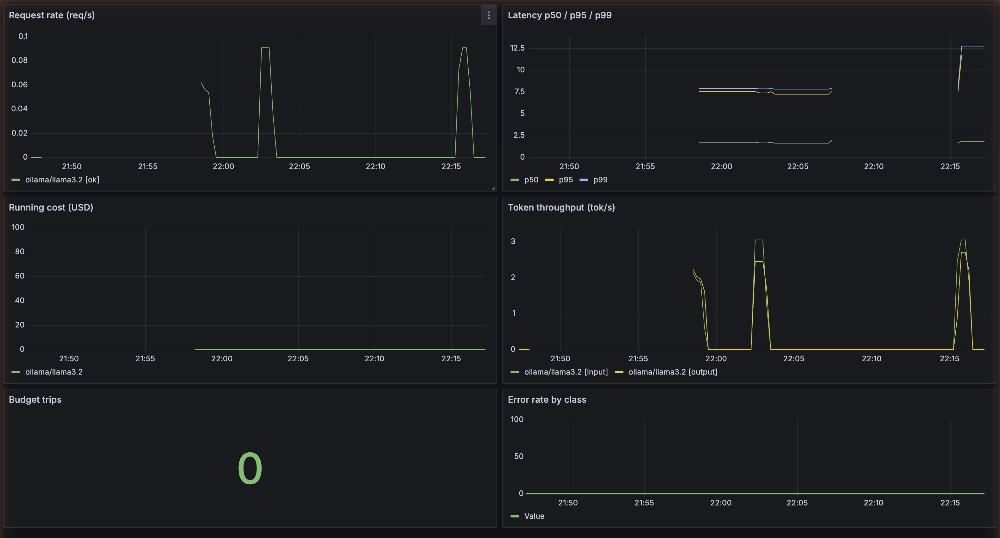

# llmops-harness

A small, opinionated Python service that wraps LLM calls with the things production systems need: metrics, traces, token/cost budgets, structured retries, and a replayable eval harness.

Built as the substrate for RAG and agent systems — not the end product. If you can't see it, you can't trust it. If you can't budget it, it will bankrupt you. This repo is the "see it" and "budget it" layer.



*Historical Grafana dashboard example. Dashboard JSON is retained; bundled Grafana is paused until its signed data-source plugins have patched dependencies.*

## What's in the box

- **Multi-provider client** (LiteLLM) — Claude, GPT, Gemini, and local Ollama behind one interface
- **Prometheus metrics** — latency histograms, token counts, cost per call, error classes, cache hits
- **OpenTelemetry tracing** — end-to-end spans across chained calls (so a multi-step agent is debuggable)
- **Token + cost budgets** — hard caps per request and per session; fail loudly, not silently
- **Retry policy** — exponential backoff with per-error-class rules (rate limit vs. provider error vs. context length)
- **Eval harness** — YAML-defined suites replayed on demand; emits quality scores alongside cost and latency
- **Grafana dashboard** — ships as JSON in the repo (see screenshot above)
- **Docker-compose observability stack** — rebuilt Prometheus + Jaeger with dependency audits

## Why this exists

Most LLM demo code looks like `client.chat(messages)` in a notebook. Most LLM production code looks like an on-call engineer wondering why the p99 latency is 40 seconds and why the bill is $8,000 and nobody knows which feature did it. This repo is the shape that sits in between.

## Quickstart

```bash
# Clone and install
git clone https://github.com/gleis/llmops-harness.git
cd llmops-harness
python -m venv .venv && source .venv/bin/activate
pip install --require-hashes -r requirements-dev.lock
pip install --no-deps -e .

# Stand up the observability stack (Prometheus + Jaeger)
docker compose -f deploy/docker-compose.yml up --build -d

# Copy env template and fill in your provider keys
cp .env.example .env

# Run the wrapped server
uvicorn llmops_harness.server:app --reload

# Hit it
curl -X POST http://localhost:8000/v1/complete \
  -H "Content-Type: application/json" \
  -d '{"provider": "ollama", "model": "llama3.2", "prompt": "Say hi."}'

# Replay the eval suite
python -m llmops_harness.evals --suite evals/suites/basic.yaml

# View metrics and traces
open http://localhost:16686       # Jaeger
open http://localhost:9090        # Prometheus
```

## Metrics exposed

| Metric | Type | Labels | Purpose |
|--------|------|--------|---------|
| `llm_request_duration_seconds` | Histogram | provider, model, status | p50/p95/p99 latency |
| `llm_tokens_total` | Counter | provider, model, kind (input/output) | Token volume |
| `llm_cost_usd_total` | Counter | provider, model | Running spend |
| `llm_requests_total` | Counter | provider, model, status | Request volume + error rate |
| `llm_budget_exceeded_total` | Counter | budget (request/session) | Hard-limit trips |
| `llm_cache_hits_total` | Counter | provider, model | Cache effectiveness |

The Grafana dashboard in `dashboards/llmops-harness.json` renders all of these as a single board.

## Project status

**v0.2 — maintained observability companion.** Locked dependencies, budget enforcement, metrics, tracing, evaluation and protocol smoke checks, and a rebuilt Prometheus/Jaeger stack are available. ModelRoute pairing is documented below. Reference RAG handlers, human approval agents, and a merged telemetry schema remain future work.

## License

MIT.

## Maintenance (2026-11-06)

This repository remains the observability and budget companion to [ModelRoute](https://github.com/gleis/ModelRoute). ModelRoute owns routing policy; this package owns budgets, metrics, tracing, and provider evaluations. A merged telemetry schema and production consumer integration remain future work. The package remains usable independently. Install the hashed `requirements-dev.lock`, then `pip install --no-deps -e .` for development.

### Reproducible protocol smoke

Run `python scripts/protocol-smoke.py` after installing the locked development dependencies. This starts isolated loopback HTTP services, exercises real LiteLLM transport, the shell smoke script, metrics, token-budget rejection, and five eval cases. Responses come from a deterministic Ollama protocol fixture; this checks integration plumbing, not model quality. It requires no provider credentials or model downloads and also runs in CI. Run the ordinary eval suite against a real local model to assess its answers.

### Observability container security review

Current upstream Prometheus, Grafana, and Jaeger images contain known bundled
dependency findings, so upgrading tags alone does not meet a zero-known-vulnerability target.
The proposed default Compose stack builds Prometheus and Jaeger from pinned source
and checked matching UI archives, recorded Go module locks with patched `x/net`
and `x/crypto`, and Go 1.27.3. An isolated equivalent in `deploy/secure/compose.yaml`
passed final-image vulnerability scans, UI checks, real harness metric scrape/query,
and OTLP trace ingestion/query in CI.

Grafana is temporarily absent: its current signed Prometheus/Jaeger catalog plugins
still contain affected dependencies. Rebuilding those binaries invalidates their
signatures. Signature validation is preserved. Dashboard JSON and provisioning
files remain for a future patched release.

The new project and Prometheus store do not reuse or alter the previous Grafana
or Prometheus volumes. Stop any old stack before binding the same ports, without
removing its volumes. Do not use `down --volumes` to migrate existing installations.

On Linux, keep the host harness on loopback and use the host-network Prometheus
override (Docker Compose 2.24 or newer):

```sh
docker compose -f deploy/docker-compose.yml -f deploy/compose.linux.yml up --build -d
```

On Docker Desktop/macOS, use the base Compose file; `host.docker.internal` reaches
the host harness. The final deployment smoke uses the Linux override and keeps the harness on
loopback too.
